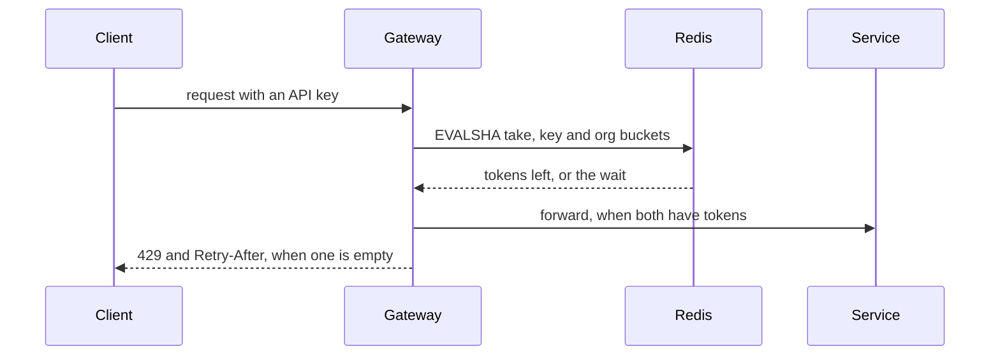

# API Rate Limits

Every public API key gets a token bucket in Redis. The gateway takes one token for each request, before any service
code runs. When a bucket is empty, the gateway answers `429` with `Retry-After`. One client can then no longer slow
the API for all other clients.

## Context

- The gateway is `gateway/`. Each request runs through the middleware in `gateway/src/pipeline.ts`, in order, and the
  gateway then sends it on to its service. Authentication is the first middleware; it sets `req.apiKey` (`{ id, orgId }`) or
  answers `401`.
- The gateway reaches Redis through its existing client, `gateway/src/redis.ts`.
- A **bucket** holds up to `burst` tokens and refills at `rate` tokens per second. A request takes one token.

## Decisions

- Count with a [token bucket](https://en.wikipedia.org/wiki/Token_bucket): one bucket per API key and one per
  organization. A request takes a token from both, or from neither.
- One Lua script reads and updates both buckets for each request. The gateway calls it with `EVALSHA`, so the check
  is atomic.
- When Redis does not answer within 20 ms, let the request through and add 1 to the metric
  `rate_limit_redis_timeout_total`. Fire the alert `RateLimitRedisDown` when this metric rises for 1 minute.
- Ship in shadow mode: log what would be rejected, and reject nothing.
- No customer has a higher limit at launch. `overrides` holds later ones, by organization id.

## Behavior

| Case | The gateway | Headers it adds |
|---|---|---|
| No valid API key | answers `401`, as today | none |
| Tokens left in both buckets | forwards the request | `RateLimit-Remaining`: the smaller of the two counts |
| A bucket is empty, `mode: shadow` | forwards the request and logs `rate_limit.would_reject` with the key id | `RateLimit-Remaining: 0` |
| A bucket is empty, `mode: enforce` | answers `429` with the body `{"error":"rate_limited"}` | `Retry-After`: whole seconds until both buckets hold a token |
| Redis takes over 20 ms | forwards the request | none |



## Interfaces

```ts
// gateway/src/limits/config.ts
export interface Limit { rate: number; burst: number } // tokens per second, bucket size
export interface LimitsConfig {
  mode: 'shadow' | 'enforce';
  key: Limit;                       // each API key
  org: Limit;                       // each organization
  overrides: Record<string, Limit>; // an organization's own limit, by org id
}
```

`gateway/config/limits.yaml` holds the config. The gateway loads it at start and again on `SIGHUP`:

```yaml
mode: shadow
key: { rate: 10, burst: 100 }
org: { rate: 50, burst: 500 }
overrides: {}
```

Redis keys are `rl:key:<key id>` and `rl:org:<org id>`, each a hash of `tokens` and `ts` (milliseconds). Each expires
`burst / rate` seconds after its last use.

## Work

Two pull requests, the second built on the first.

1. **Limits in shadow mode.** Add `gateway/src/limits/`: the config loader, the Lua script and the middleware.
   Register the middleware in `gateway/src/pipeline.ts` right after authentication. Add the metric and the alert.
   Tests: the script against a real Redis (refill, burst, both buckets), and the middleware with Redis made to time
   out.
2. **Enforce.** With `mode: enforce`, answer `429` with `Retry-After`. Tests: the status, body and headers of each
   case in the table under Behavior.

## Out of scope

- Limits by IP address or by endpoint.
- A dashboard for limits: the logs and the metric are enough.
- New values in `limits.yaml`. The team sets them from the shadow-mode logs after this ships.

## Done when

- `bun test gateway/src/limits` passes, the Redis timeout case included.
- With `mode: shadow`, one key that sends 150 requests within 100 ms gets 150 answers from the service and at least
  49 `rate_limit.would_reject` log lines.
- With `mode: enforce`, the same burst gets at most 101 answers from the service and at least 49 `429` answers, each
  with `Retry-After: 1`.
- With Redis stopped, every request reaches its service, and `rate_limit_redis_timeout_total` counts each one.
